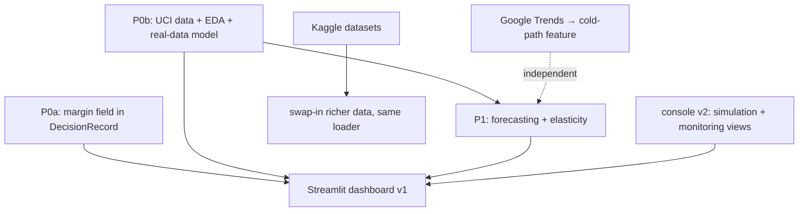

# 🗺️ Roadmap — Data Science Layer (P0 → P1)

> Sequenced by **dependency**, not by desire. Each step names what it unblocks,
> what gates it, and what it must NOT do (anti-scope-creep). Contracts stay
> additive throughout — every step leaves the previous one green.

## Dependency logic (why this order)

- **A before everything**: charts need the margin field; it is the smallest,
  purely additive change — cheapest foundation to lay first.
- **B before C**: a dashboard over *only* synthetic/seed data is decoration;
  UCI gives the EDA section (their phase 1) something true to show, and gives
  forecasting/elasticity real series to learn from.
- **B before F**: elasticity and forecasting are *fit on historical series* —
  UCI is the first honest source (Kaggle later swaps in behind the same loader).
- **C after A+B**: dashboard v1 charts decisions/margin/signals (A) + EDA/model
  artifacts (B). Forecasting/elasticity sections arrive empty and get filled
  when F lands — sections are planned, not faked.
- **E last**: Google Trends is an unofficial API (ToS-gray) and adds a feature,
  not a foundation.

## The steps

### Step 1 — P0a: Expected impact in every decision
- **Delivers**: `impact {unit_margin, margin_pct, projected_daily_margin, basis}` in
  the DecisionRecord (additive, optional), computed purely in core; console
  explain row; API docs.
- **Answers**: their question 4 (expected profit impact).
- **Gate**: full suite (189+) + contract gate + HTTP gate; old records (without
  `impact`) still render.
- **Effort**: small. **Rollback**: single revert, no migration.

### Step 2 — P0b: UCI real-data training + EDA
- **Delivers**: UCI retail dataset downloader (open, no auth), loader →
  `fv-2026.11` feature mapping, EDA report (distributions, price/demand
  scatter, correlation), model trained on real data through the **same eval
  gates**, synthetic kept as the leakage *control*.
- **Answers**: their phase 1 (EDA) + section 5 (datasets).
- **Gate**: eval gate passes with real-data baseline recorded; EDA report
  committed under `reports/`; synthetic-vs-real comparison table.
- **Effort**: medium. **Rollback**: model artifacts are versioned — swap back
  to synthetic baseline by pointer, no code revert needed.

### Step 3 — Streamlit dashboard v1
- **Delivers**: `dashboard/app.py` — 7 sections over the **existing** API +
  decision log: Market Overview (price/margin history), Competitor
  Intelligence (signal timeline, competitor vs our price), Recommendations
  (recent decisions + impact), Demand/Elasticity/Forecasting sections
  **reserved with honest "coming in step 4" placeholders**, Model Monitoring
  (eval f1 history, latency p99, drift flags).
- **Answers**: their section 6 — visible data-science surface.
- **Gate**: runs locally (`streamlit run dashboard/app.py`), read-only against
  the API, no new write paths; suite untouched (dashboard tested by import +
  smoke only).
- **Effort**: medium. **Rollback**: folder removal — zero impact on engine.

### Step 4 — P1: Forecasting + elasticity (the DS core)
- **Delivers**: demand forecast model (their LR → RF → XGB ladder with
  backtest protocol), **elasticity estimator** (E_d per SKU/category,
  validated against the synthetic oracle first — our unfair advantage),
  both exposed as API endpoints → dashboard sections 3 & 4 get filled;
  forecast feeds Step 1's `projected_daily_margin` upgrade (honest forecast
  instead of current-velocity).
- **Answers**: their sections 3B/3C + question 2/5.
- **Gate**: backtest metrics recorded; elasticity estimator vs oracle error
  below threshold; eval suite extended (≥20 cases per new model per the
  deployment rule).
- **Effort**: medium-large. **Rollback**: new endpoints are additive; primary
  pricing path untouched (these *inform*, the ModelPort still decides).

### Step 5 — Kaggle swap-in
- **Delivers**: Kaggle loader behind the **same interface** as the UCI loader
  (needs your Kaggle API token once); richer sales data → retrain →
  re-record baseline.
- **Gate**: same eval gates; loader interface unchanged (a drop-in, not a
  redesign).
- **Effort**: small (once credentials exist). **Rollback**: loader flag.

### Step 6 — Google Trends demand signal
- **Delivers**: Trends collector → cold-path feature (`trend_interest`
  category-level), enters with low `source_trust` + circuit breaker, ToS-gray
  note recorded in the source registry.
- **Gate**: source-registry tests + feature-manifest update (additive);
  extraction/eval gates untouched.
- **Effort**: small. **Rollback**: source `enabled: false`.

## Anti-scope-creep (forbidden in this phase)
- ❌ Rewriting the engine/folder structure to match the pasted plan
- ❌ A third UI (console + Streamlit is the pair; no React app)
- ❌ PostgreSQL/Kafka changes (ports exist; no trigger yet)
- ❌ Claiming "real-time forecasting" — forecasts are periodic; labeled as such
- ❌ Any contract change that is not additive

## Definition of done (this phase)
Dashboard shows **real data** end-to-end: UCI-trained model + EDA + margin
impact + monitoring, all served through the gated API — with the engine's
189+ tests, contracts, and evals still green.
