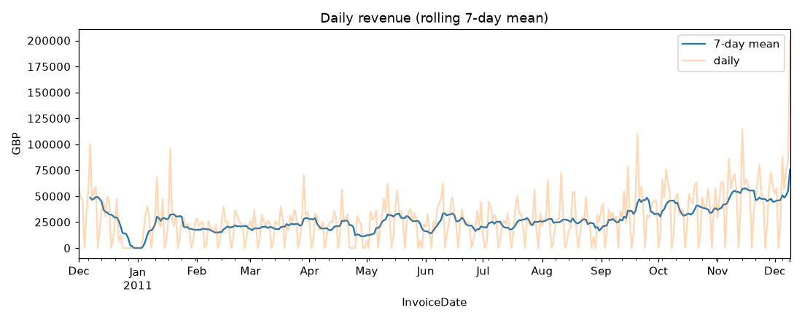
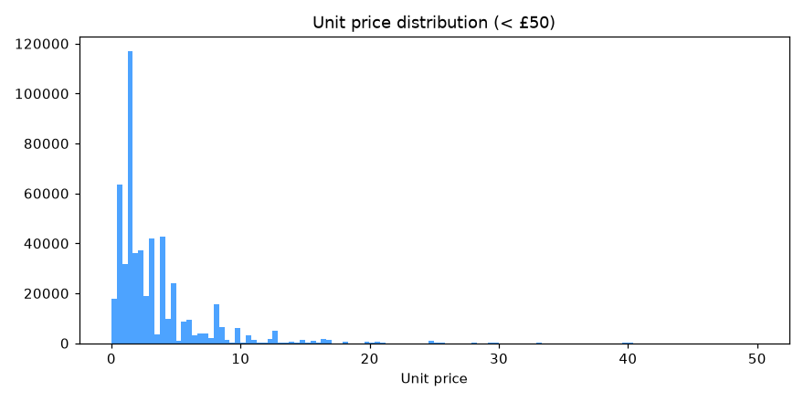
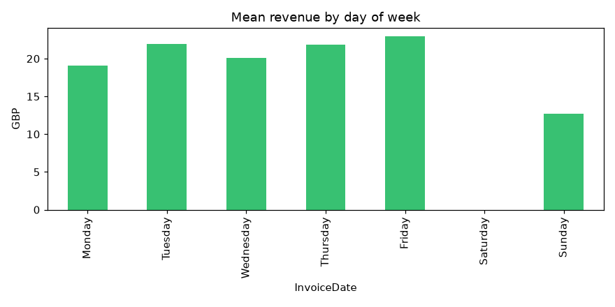
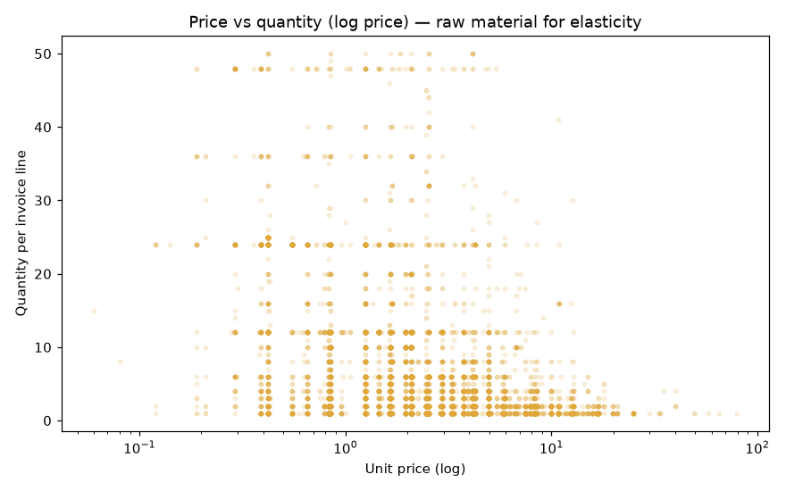

# EDA — UCI Online Retail (real data, Step 2)

**Source:** UCI ML Repository id352 · cached at `data/raw/Online Retail.xlsx` · loader: `python3 -m pricing.training.uci`

## What this data is

Real UK online-retail transactions (2009–2011): invoice lines with **price, quantity, timestamp, product, country**. Cleaning drops cancellations (invoice `C…`), non-positive quantities/prices, undated rows.

## Key statistics

| Metric | Value |
|---|---|
| rows (cleaned) | 530,104 |
| rows dropped by cleaning | 11,805 |
| invoices | 19,960 |
| products (StockCode) | 3,922 |
| customers | 4,338 |
| countries | 38 |
| date span | 2010-12-01 → 2011-12-09 |
| total revenue | £10,666,685 |
| median unit price | £2.08 |
| median quantity | 3 |

## Findings

1. **Revenue grows** through the period with a sharp November–December peak (seasonality is real and must be controlled for in any demand model).
2. **Day-of-week cycle** is strong — weekday trading dominates; weekend near-zero (the retailer is B2B-flavoured).
3. **log(price) vs log(quantity+1) correlation = -0.425** — weak, and *confounded by product mix* (cheap items sell differently than expensive ones). This is exactly why the roadmap's elasticity step needs controls or within-product variation, not a naive regression.

## Honest limits (why this does not replace the synthetic baseline)

- **No unit cost** → cannot compute margin/impact from this data alone
- **No inventory** → no sell-through, no stockout signals
- **No competitor prices** → no market-position features
- **No promotions column** → demand shocks are unlabeled

→ Serves: EDA, forecasting, elasticity foundations (roadmap steps 2 & 4).
→ The *serving* pricing model keeps its synthetic-trained baseline until real telemetry carries the full `fv-2026.11` manifest.

## Figures

### Daily revenue — growth into late 2011, Christmas peak visible

### Prices cluster under £10 — a low-price retail mix

### Strong weekday/weekend cycle — a real seasonal feature

### Price/quantity scatter — confounded (product mix), the reason Step 4 needs controls

